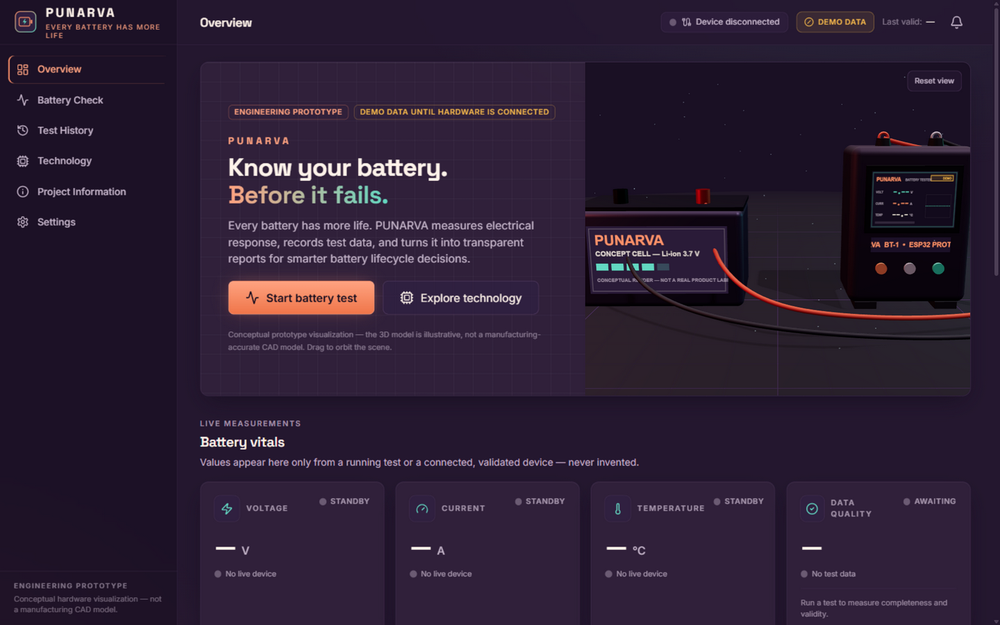
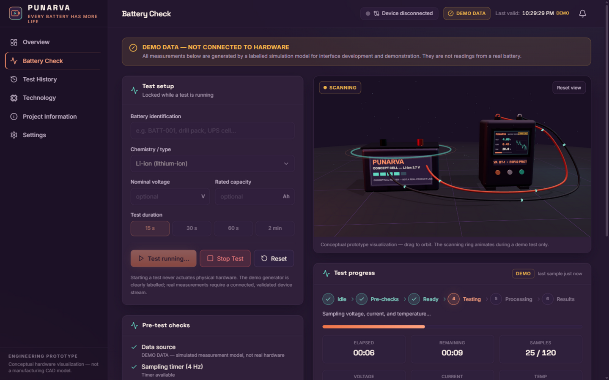
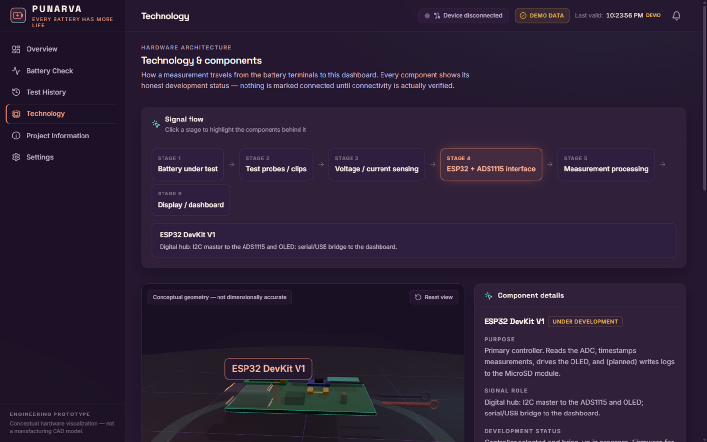
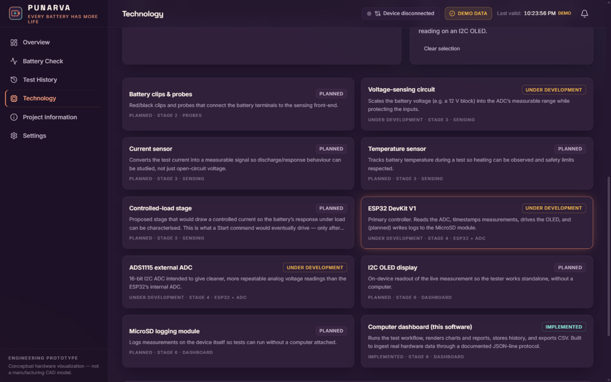

<div align="center">

# ⚡ PUNARVA

### *Every Battery Has More Life.*

**A premium battery intelligence & diagnostics platform — engineering prototype**

[](https://react.dev)
[](https://www.typescriptlang.org)
[](https://vite.dev)
[](https://r3f.docs.pmnd.rs)
[](https://tailwindcss.com)
[](#-honesty--scope)

</div>

---

**PUNARVA** is the software interface for an ESP32-based battery testing prototype. It combines a cinematic 3D product visualization, a professional battery-laboratory aesthetic, and a *real, working* diagnostics workflow — test state machine, live charts, engineering reports, history, and CSV export — built to ingest honest measurements from hardware the moment that hardware is validated.

> 🔋 **KNOW YOUR BATTERY. BEFORE IT FAILS.**

---

## ✨ Screenshots

| Overview — cinematic 3D hero | Battery Check — live demo test |
| --- | --- |
|  |  |

| Technology — interactive 3D assembly | Technology — honest component statuses |
| --- | --- |
|  |  |

---

## 🚀 Quick start

```bash
# 1. Install dependencies (Node 18+)
npm install

# 2. Run the development server
npm run dev          # → http://localhost:5173

# 3. Production build & preview
npm run build
npm run preview      # → http://localhost:4173
```

| Script | What it does |
| --- | --- |
| `npm run dev` | Start the Vite dev server with hot reload |
| `npm run build` | Type-check (`tsc -b`) **and** production build — CI-safe |
| `npm run lint` | ESLint over the whole project |
| `npm run preview` | Serve the production build locally |

---

## 🧭 What's inside

| Route | Screen | Highlights |
| --- | --- | --- |
| `/` | **Overview** | WebGL hero: conceptual battery + PUNARVA tester with red/black test leads, live metric cards, response charts, recent tests, connection panel, system event log |
| `/battery-check` | **Battery Check** | Full test workflow `IDLE → PRE-CHECKS → READY → TESTING → PROCESSING → RESULTS` (+ `DISCONNECTED`, `ERROR`), 15 s / 30 s / 60 s / 2 min durations, scanning-ring 3D animation, live charts |
| `/results/:id` | **Test report** | Engineering report: min/max/avg statistics, response curves, completeness, data-quality warnings, CSV export |
| `/history` | **Test History** | Search + filters, local persistence, per-record reports, CSV import/export, storage honesty banner |
| `/technology` | **Technology** | Clickable signal-flow diagram, interactive 3D component assembly, per-component development status |
| `/about` | **Project Information** | Problem, solution, 5-stage workflow, current vs. future development |
| `/settings` | **Settings** | Web Serial device connection, payload protocol, motion preferences, storage management, browser support |

### Feature checklist

- 🎨 **Plum / copper / sea-glass-teal design system** — no generic black-and-white; layered gradients, fine technical grids, restrained glow
- 🧊 **Real WebGL 3D** (Three.js + React Three Fiber + Drei) — procedural battery, tester, display with live readout texture, energy pulses, scanning ring; graceful fallback when WebGL is unavailable
- 📈 **Recharts instrumentation** — voltage / current / temperature vs. time with units, tooltips, and *visible gaps for missing samples*
- 🧪 **A real test engine** — duplicate-start protection, complete timer cleanup, partial-data reports when stopped, deterministic 4 Hz sampling
- 💾 **Persistent history** with graceful in-memory fallback when browser storage is unavailable
- 📤 **CSV export & validated import** — exports contain the actual samples; imports are strictly validated with precise errors
- 🔌 **Modular device layer** — Web Serial transport, strict payload validation, staleness/rejection handling, ready for a WebSocket bridge
- ♿ **Accessibility & performance** — visible focus states, keyboard navigation, `prefers-reduced-motion` respected in CSS *and* in the 3D scene
- 📱 **Responsive** — sidebar collapses into a drawer on mobile; layouts verified at laptop/tablet/phone widths

---

## 🏗 Architecture at a glance

```
Battery under test → Test probes → Voltage/current sensing → ESP32 + ADS1115
                                                            ↓
                            Display / dashboard ← Measurement processing
```

Software side:

```
src/
├─ components/          # UI kit, layout shell, 3D scenes, charts, domain widgets
│  ├─ three/            # BatteryTesterScene, TesterAssemblyScene, WebGL guard & fallback
│  ├─ charts/           # Recharts time-series with honest gaps
│  └─ …
├─ pages/               # One component per route
├─ state/               # Zustand stores + the TestEngine state machine
├─ services/            # Device transports, validation, demo sampler, CSV, storage
├─ data/                # Component catalogue, chemistries
└─ lib/                 # Formatting, IDs, class helpers
```

Deep dives live in [`docs/`](docs):

- 📘 [Architecture](docs/ARCHITECTURE.md) — stack, state model, data flow, design system
- 🔌 [Hardware integration](docs/HARDWARE_INTEGRATION.md) — how the ESP32 will talk to this dashboard
- 📄 [CSV format](docs/CSV_FORMAT.md) — export/import schemas and validation rules

---

## 🧪 Verified before shipping

The following were executed and passed on the shipped code:

- ✅ `npm run build` — TypeScript strict check + Vite production build, zero errors
- ✅ `npm run lint` — zero errors
- ✅ Full demo test run in a real browser: start → pre-checks → ready → testing (4 Hz samples) → processing → results
- ✅ Stop/reset controls, duplicate-start protection, timer cleanup
- ✅ CSV export fires a real download; history records persist and re-open
- ✅ All routes render; invalid result IDs and unknown routes show clean empty states
- ✅ WebGL scenes render in-browser; the non-WebGL fallback path is code-reviewed and isolated

---

## 🪪 Honesty & scope

This is an **engineering prototype**, and the software is deliberate about what it does *not* claim:

- 🔴 **No device is connected by default.** Without hardware, every measurement on screen comes from a clearly labelled simulation — banners, badges, and chart tags all say **DEMO / SIMULATED**.
- 🚫 **The website can never actuate a physical load.** Load control requires validated firmware, a safe protocol, and electrical protection that do not exist yet.
- 🧾 **No fabricated intelligence.** Reports never show state-of-health, internal resistance, remaining capacity, safety certification, or failure predictions. Until a validated estimator exists, reports state:
  > *Battery health assessment unavailable — validated test data and calibration required.*
- 🗄 **Browser storage ≠ MicroSD.** Local records are explicitly labelled as browser-local; device records appear only after an explicit CSV import.
- 🧊 **The 3D models are conceptual**, not manufacturing-accurate CAD.

---

## 🗺 Roadmap

| Stage | Item | Status |
| --- | --- | --- |
| 1 | ESP32 + ADS1115 acquisition bring-up | 🟡 Under development |
| 1 | Voltage-sensing circuit finalisation | 🟡 Under development |
| 2 | Current / temperature sensors, OLED, MicroSD logging | ⚪ Planned |
| 2 | Controlled-load stage (with protection) | ⚪ Planned |
| 3 | Calibration & repeatable testing | ⚪ Planned |
| 3 | Validated battery-health estimation | ⚪ Planned |
| 4 | AI/ML analysis after sufficient real data | ⚪ Planned |
| 4 | Second-life evaluation support | ⚪ Planned |

---

<div align="center">

**PUNARVA** — built for *Innovation Day* 🔬

*Measure honestly. Report transparently. Every battery has more life.*

</div>
